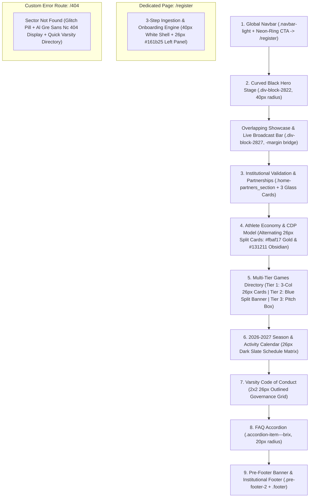

# Kirinyaga University Esports — Design System & Layout Architecture (`DESIGN.md`)

> **Design Source of Truth**: Derived from a forensic inspection of `designs/tribecarry1stsite/` (`community.html`, `index.html`, `shop.html`, `carry1st-discount-points.html`, `africa-cup.html`, `affiliate-program-faqs.html`, and the Webflow production stylesheet `carry1st-v1.webflow.shared.881a15021.css`) combined with brand assets in `designs/imgs/` (`tribelogo.svg`, `kyu_logo2.svg`, `tribedesign.png`).
>
> **Content Source of Truth**: All copy, data points, game tiers, CDP reward figures, seasonal calendar dates, and ingestion workflows come **exclusively** from [`docs/tribecontent.md`](./docs/tribecontent.md).

---

## 1. Visual Philosophy & How the Site is "Printed"

The `tribecarry1stsite` design language—specifically its **Tribe Community (`community.html`)** and **Carry1st Shop/CDP (`shop.html`, `carry1st-discount-points.html`)** layouts—is built around a **High-Contrast Dark Arena Canvas** punctuated by **Giant Condensed Display Typography**, **Deeply Rounded Card Containers (`26px` and `40px` radii)**, and **Tactile Color-Blocked Split Sections**.

Rather than flat, edge-to-edge horizontal bands, the site is "printed" on screen as a vertical stack of **self-contained architectural blocks** floating inside a generous `80px` horizontal gutter (`1280px` max container):
1. **Top Curved Black Stage (`40px` bottom radius)** with subtle geometric/topographic wireframe watermarks at low opacity (`8%–36%`).
2. **Negative-Margin Overlapping Bridge (`-400px` desktop / `-168px` mobile)** where the primary visual/showcase container breaks out of the black hero stage and bridges into the warm obsidian body canvas (`#121110`).
3. **Alternating `26px` Rounded Split Feature Cards** (`height: 550px` desktop) that alternate between **Tribe Gold (`#fbaf17`) with dark ink** and **Obsidian (`#131211`) or Carry1st Blue (`#08a3e1 -> #0a6bd1`) with white/gold ink**, creating rhythmic visual pacing down the page.
4. **3-Column Outlined & Frosted-Glass Cards (`26px` radius, `3px solid` borders)** for scannable pillars, multi-tier directories, and governance rules.
5. **Dual-Tone `40px` Split Conversion Engine (`#form` / `#register`)** that pairs a **Dark Navy-Slate (`#161b25`) instruction panel** on the left inside a **Crisp White (`#ffffff`) outer form shell** on the right—creating maximum visual focus and trust at the moment of student registration.

---

## 2. Color System & Surface Tokens

Extracted directly from `carry1st-v1.webflow.shared.881a15021.css` and `designs/imgs/`:

### 2.1 Background & Surface Hierarchy
| Token Name | Hex / Value | Source Selector in `tribecarry1stsite` | Usage in KyU Esports Portal |
| :--- | :--- | :--- | :--- |
| `--bg-canvas-obsidian` | `#121110` | `body.dark-2` (`community.html`) | Primary page background canvas |
| `--bg-hero-stage` | `#000000` | `.div-block-2822` (`community.html`) | Curved top hero stage (`border-radius: 0 0 40px 40px`) |
| `--bg-card-obsidian` | `#131211` | `.communituy-3` (`community.html`) | Dark split feature cards & secondary dark containers |
| `--bg-main-dark` | `#161b25` | `--main-dark` / `.contact-left-content.comm` | Left dark panel of the 3-Step Registration Engine, dark pill buttons, game cards |
| `--bg-elevated-slate` | `#191f2a` | `.page-wrapper.dark` / `.div-block-2761` | Elevated cards, schedule table rows, dropdowns, modal surfaces |
| `--bg-glass-card` | `linear-gradient(313deg, transparent, rgba(255, 255, 255, 0.03))` | `.key-feature-wrapper` (`shop.html`) | 3-column institutional validation & governance cards (`backdrop-filter: blur(20px)`) |
| `--bg-form-shell` | `#ffffff` | `.contact-component.comm` | Outer shell of the 3-Step Ingestion Engine (`#register`) |
| `--bg-input-fill` | `#eceef0` | `.contact-field` | Form inputs (`height: 46px`, `border-radius: 8px`) inside the white registration card |

### 2.2 Brand & Accent Tokens
| Token Name | Hex / Value | Source Selector in `tribecarry1stsite` | Usage in KyU Esports Portal |
| :--- | :--- | :--- | :--- |
| `--accent-tribe-gold` | `#fbaf17` | `.text-color-yellow`, `.community-2`, `.heading-22` | Primary Tribe Amber/Gold card surface, section keyword highlights, Tier 1 badges |
| `--accent-hero-yellow` | `#fbb529` | `.heading-23 .yellow` (`community.html`) | Hero display headline highlight span |
| `--accent-submit-amber` | `#fbaf19` | `.submit-button-2.orange` | Primary form submission pill button (`color: #000`) |
| `--accent-carry1st-blue` | `#00a1e1` | `--main-blue` / `.primary-button-6.is-blue` | Carry1st Electric Cyan for links, button hover states, Tier 2 accents |
| `--gradient-carry1st-blue` | `linear-gradient(132deg, #07a3e1, #0a60cd)` | `.join-section-2.shop`, `.div-block-2664` | Blue split banner card & icon badge containers |
| `--gradient-neon-pill` | `linear-gradient(264deg, #ff00e5, #00f0ff)` | `.nav-button-wrapper` | `3px` animated/high-visibility border ring around the Navbar `[Claim Your Roster Spot]` CTA |
| `--accent-kyu-emerald` | `#22c55e` / `#E0F0D1` | `kyu_logo2.svg` & live status indicators | Kirinyaga University varsity verification badge, live broadcast dot, WhatsApp routing confirmation |

### 2.3 Border & Typography Ink Tokens
| Token Name | Hex / Value | Source Selector in `tribecarry1stsite` | Usage in KyU Esports Portal |
| :--- | :--- | :--- | :--- |
| `--border-dark-card` | `#1a1919` (`3px solid`) | `.div-block-2834` (`community.html`) | 3-column dark card outlines |
| `--border-slate-card` | `#202835` (`3px solid`) | `.key-feature-wrapper` (`shop.html`) | Glass card & table outlines |
| `--border-subtle-divider` | `rgba(217, 217, 217, 0.5)` | `.feature-divider` | `1px` horizontal separator inside feature cards |
| `--ink-white` | `#ffffff` | `.text-color-white` | Primary display headings and titles on dark surfaces |
| `--ink-light-white` | `rgba(255, 255, 255, 0.8)` (`#fffc`) | `.text-color-light-white` | Primary body copy on dark surfaces |
| `--ink-muted-slate` | `#7e8a9e` | `.grey-2` / `.footer-copyright` | Eyebrow labels, partner strip headings, table headers, footer metadata |
| `--ink-dark` | `#161b25` / `#000000` | `.text-color-dark` / `.paragraph-264` | High-contrast dark ink used on `#fbaf17` Tribe Gold cards and the `#ffffff` registration card |

---

### 3.1 Font Stack
In `tribecarry1stsite`, the visual voice comes from pairing the authentic **ultra-condensed, tall, uppercase display typeface** (`Al Gre Sans Nc`, self-hosted at `/fonts/AlGreSansNc.ttf`) at `line-height: 1.0` with a **clean geometric sans-serif body font** (`Poppins`):

- **Display / Impact Headings (`--font-display`)**:
  - `'Al Gre Sans Nc'`, `'Karantina'`, `'Barlow Condensed'`, sans-serif (self-hosted `@font-face` + Google Fonts fallback)
  - Always rendered **UPPERCASE** (`text-transform: uppercase`), tight leading (`line-height: 0.95` to `1.0`), `font-weight: 400` / `700`, with key action words wrapped in `<span class="text-tribe-gold">` (`#fbaf17` / `#fbb529`) or `<span class="text-carry1st-blue">` (`#00a1e1`).
- **UI & Body Copy (`--font-sans`)**:
  - `'Poppins'`, system-ui, -apple-system, sans-serif (`weights: 300, 400, 500, 600, 700`).
- **Tabular Data & Student IDs (`--font-mono`)**:
  - `'JetBrains Mono'` or `'IBM Plex Mono'` (used for `CT101/G/XXXXX/XX` format hints, `52,000–259,000 CDP` figures, and tournament timestamps).

> **Architectural Revision (Clean Impact Rule)**: All artificial pill-style eyebrow chips and status bars have been removed across all sections. Section titles now lead with direct, bold, uppercase `Al Gre Sans Nc` display typography to mirror the clean, authoritative Carry1st Tribe look without visual tag clutter.

### 3.2 Responsive Type Scale (Exact Webflow Breakpoints)
| Role | Reference Class | Desktop (`>=992px`) | Tablet (`<=991px`) | Mobile (`<=479px`) | Line Height & Style |
| :--- | :--- | :--- | :--- | :--- | :--- |
| **Hero Display (H1)** | `.heading-23`, `.heading` | `90px` (`5.625rem`) | `60px` (`3.75rem`) | `50px` (`3.125rem`) | `1.0`, Uppercase Display, centered |
| **Section Display (H2)** | `.heading-2`, `.heading-17`, `.heading-19` | `80px` (`5rem`) | `45px` (`2.8125rem`) | `35px–40px` (`2.25rem`) | `1.0`, Uppercase Display |
| **Banner / Split Card H3** | `.heading-22`, `.heading-26` | `45px–48px` (`2.85rem`) | `35px–36px` (`2.2rem`) | `26px–30px` (`1.75rem`) | `1.0`–`1.1`, Uppercase Display |
| **Card Title (H4)** | `.paragraph-265`, `.heading-28` | `22px–26px` | `20px–22px` | `20px` | `1.25`, Poppins `600`/`700` |
| **Lead Paragraph** | `.text-size-large`, `.paragraph-264` | `18px–20px` | `18px` | `16px` | `1.5`–`1.6`, Poppins `400` |
| **Standard Body** | `.text-size-medium`, `.text-size-medium-11` | `16px–18px` | `16px` | `15px` | `1.6`, Poppins `400` (`#fffc` on dark) |
| **Card Body / Form Label** | `.text-size-medium-12`, `.field-label` | `15px–16px` | `15px` | `14px` | `1.5`, Poppins `400`/`500` |
| **Eyebrow / Badge Pill** | `.paragraph-261`, `.nav-link` | `14px–15px` | `14px` | `13px` | `1.2`, Uppercase, `letter-spacing: 0.08em` |

---

## 4. Layout, Grid & Spacing System ("Page Print Mechanics")

### 4.1 The 3-Layer Structural Wrapper
Every section in `tribecarry1stsite` uses a strict 3-layer nesting pattern to guarantee alignment across ultra-wide monitors and mobile screens:
```html
<section class="section-[name]">
  <div class="padding-global">
    <div class="container-large">
      <div class="padding-vertical padding-[size]">
        <!-- Section Content -->
      </div>
    </div>
  </div>
</section>
```

- **`.padding-global` (Mobile-First Horizontal Page Gutters)**:
  - Base Mobile (`320px–479px`): `padding-left: 1rem; padding-right: 1rem;` (`16px`, prevents viewport clipping on compact phones)
  - Phablet / Large Mobile (`>=480px`): `padding-left: 1.5rem; padding-right: 1.5rem;` (`24px`)
  - Tablet Portrait (`>=768px`): `padding-left: 2.5rem; padding-right: 2.5rem;` (`40px`)
  - Desktop Monitor (`>=1200px`): `padding-left: 5rem; padding-right: 5rem;` (`80px`)
- **`.container-large` (Max Content Width)**:
  - `width: 100%; max-width: 80rem (1280px); margin-left: auto; margin-right: auto;`
- **`.padding-vertical` (Mobile-First Vertical Rhythm)**:
  - `padding-medium`: `2rem` (`32px` top & bottom)
  - `padding-large`: `2.5rem` (`40px` mobile) / `3rem` (`48px` desktop)
  - `padding-huge`: `3rem` (`48px` mobile) / `4rem` (`64px` tablet) / `5.3rem` (`85px` desktop)
  - `padding-xhuge`: `3.5rem` (`56px` mobile) / `5rem` (`80px` tablet) / `7.3rem` (`116px` desktop)

### 4.2 Corner Radius System (`:root` Tokens & Mobile-First Behavior)
- **`--round-corner-1` (`40px` desktop / `24px` mobile)**:
  - Applied to the bottom of the black hero stage (`.div-block-2822` / `.hero-stage-black`) and the outer shell of the 3-Step Registration Card (`.registration-shell-white`).
- **`--round-corner-2` (`26px` desktop / `20px` mobile)**:
  - Applied to all major split feature cards (`.split-card-gold`, `.split-card-obsidian`, `.split-card-blue`), 3-column directory cards (`.division-card-dark`), frosted glass modules (`.glass-feature-card`), and the inner dark panel of the registration card (`.registration-left-dark`).
- **`--round-corner-3` (`20px` desktop / `16px` mobile)**:
  - Applied to FAQ accordion items (`.faq-accordion-item`) and schedule table matrix containers.
- **`--round-corner-4` (`8px`–`12px`)**:
  - Applied to form inputs (`.contact-field-input`), select dropdowns, and icon badge containers.
- **Pill Radius (`100px`)**:
  - Applied to **all** buttons (`.primary-button-gold`, `.primary-button-blue`, `.primary-button-white`, `.primary-button-outline`, `.nav-button-wrapper`). Mobile buttons use compact `padding: 13px 22px–24px` with minimum `46px` height to guarantee touch accessibility.

### 4.3 Mobile-First Touch Targets & Form Ergonomics
1. **iOS Safari Auto-Zoom Prevention**:
   - All text inputs, email fields, and select dropdowns use `font-size: 16px` on viewports `<768px` (`min-height: 48px`). This prevents iOS WebKit from forcibly zooming the viewport upon focus, maintaining a stable UI state.
2. **Accessible Touch Targets**:
   - All interactive elements, including FAQ accordion summaries, mobile drawer links, and division selection triggers, enforce a minimum `44px`–`48px` vertical hit area.
3. **Resilient Viewport Constraints**:
   - Nested cards (such as the telemetry card inside `.split-card-gold` and the 15-vote nomination card inside Tier 3) scale their inner padding from `p-4 sm:p-7 lg:p-8` so that inner content never squishes or clips on narrow 320px–375px screens.
4. **Mobile Navigation Drawer**:
   - Full-width fixed drawer positioned at `top: 84px` with high-blur backdrop, touch-friendly `min-h-[44px]` link targets, and auto-closing triggers on link selection and backdrop taps.

### 4.4 Background Texture & Watermark Treatment
In `community.html` and `shop.html`, large dark and gold cards never look sterile because they layer subtle geometric/topographic SVG watermarks behind the content:
- **Hero Stage**: Topographic wireframe or circuit/arena pattern (`opacity: 0.15`, `pointer-events: none`).
- **Split Cards (`#fbaf17` Gold & `#131211` Obsidian)**: Subtle Carry1st/Tribe geometric watermark (`opacity: 0.08` on dark cards, `opacity: 0.45` soft blend on gold cards) anchored to the bottom-left or top-left corner.

---

## 5. Signature UI Component Archetypes

### 5.1 Buttons (Pill Architecture)
All interactive CTAs use `border-radius: 100px`, `font-family: Poppins`, `font-weight: 500–600`, and smooth transitions (`all 0.35s ease`):
1. **Navbar Neon-Ring Pill (`.nav-button-wrapper` + `.primary-button-6`)**:
   - Outer wrapper: `padding: 3px; border-radius: 100px; background: linear-gradient(264deg, #ff00e5, #00f0ff);`
   - Inner button: `background: #161b25; color: #fff; padding: 14px 28px; border-radius: 100px; font-size: 15px;`
   - Hover: Inner background transitions to `#ffffff`, text to `#161b25`.
2. **Primary Tribe Gold Pill (`.submit-button-2.orange`)**:
   - `background: #fbaf19; color: #000000; height: 54px; padding: 0 42px; border-radius: 100px; font-weight: 600;`
   - Hover: `background: #00a1e1; color: #ffffff; transform: scale(1.03);`
3. **Carry1st Electric Blue Pill (`.primary-button-6.is-blue`)**:
   - `background: #00a1e1; color: #ffffff; padding: 18px 40px; border-radius: 100px;`
   - Hover: `background: #ffffff; color: #161b25;`
4. **Card Action White Pill (`.primary-button-12.is-white.comm`)**:
   - `background: #ffffff; color: #000000; height: 48px; padding: 0 32px; border-radius: 100px; font-weight: 500;`
   - Hover: `background: #00a1e1; color: #ffffff;`

### 5.2 Alternating `26px` Split Feature Cards (`.community-2` & `.communituy-3`)
- **Geometry**: `width: 100%; min-height: 520px; border-radius: 26px; overflow: hidden; display: flex; justify-content: space-between; align-items: stretch; position: relative;` (Stacks vertically on `<=991px`).
- **Gold Variant (`.community-2`)**:
  - Surface: `#fbaf17` (Tribe Gold).
  - Text Column (`54%` width, `padding: 50px`): Black/Dark display heading (`80px` desktop / `35px` mobile), dark body text (`18px`, `line-height: 1.6`), and dark/white pill CTA or structured data list.
  - Visual/Interactive Column (`46%` width): Full-height media or interactive progression card with a bottom dark gradient overlay (`linear-gradient(transparent, #000)`).
- **Obsidian Variant (`.communituy-3`)**:
  - Surface: `#131211` with `3px solid #1a1919` border.
  - Reversed column order (Visual/Data left `46%`, Text right `50%`).
  - Heading in `#fbaf17` (Tribe Gold), body in `rgba(255, 255, 255, 0.8)`.

### 5.3 3-Column `26px` Outlined & Glass Cards (`.div-block-2834` & `.key-feature-wrapper`)
- **Geometry**: 3-column CSS Grid / Flex (`gap: 24px`, `32%` each on desktop -> 1 column on mobile).
- **Styling**:
  - `border-radius: 26px; padding: 40px 30px; border: 3px solid #1a1919` (or `#202835` with `backdrop-filter: blur(20px)`).
  - Top row: `55x55px` rounded-`10px` icon badge (`linear-gradient(132deg, #07a3e1, #0a60cd)` or `#fbaf17` tint) + optional status pill badge (`TIER 1 VARSITY`, `OFFICIAL PARTNER`).
  - Title: `22px–24px` Poppins Bold (`#ffffff`).
  - Divider: `1px` horizontal line (`.feature-divider`, `rgba(217, 217, 217, 0.3)`).
  - Body: `15px–16px` Poppins Regular (`rgba(255, 255, 255, 0.8)`).
  - Footer: Bottom-aligned pill CTA or metadata tags.

### 5.4 Dual-Tone `40px` Split Conversion Card (`.contact-component.comm`)
- **Outer Container**: `background: #ffffff; border-radius: 40px; padding: 20px 35px 20px 20px; display: flex; justify-content: space-between; align-items: stretch; box-shadow: 0 20px 50px rgba(0, 0, 0, 0.35);`
- **Left Panel (`.contact-left-content.comm`)**:
  - `width: 45%; background: #161b25; border-radius: 26px; padding: 40px; position: relative; overflow: hidden; color: #ffffff;`
  - Houses the giant condensed heading, lead instructions, and a vertical 3-item icon+step list (`.div-block-3034`, `gap: 16px`) plus the Step 1 Carry1st Shop referral activation trigger.
- **Right Panel (`.contact-right-form`)**:
  - `width: 52%; padding: 20px 10px; color: #161b25;`
  - Houses the clean, high-trust student verification form with 2-column field rows (`.div-block-2608`), `#eceef0` filled inputs (`height: 46px`, `border-radius: 8px`), and the `#fbaf19` pill submit button.

---

## 6. Section-by-Section Page Blueprint (Mapping `tribecarry1stsite` to `docs/tribecontent.md`)

Below is the exact blueprint for how each of the **10 sections** in [`docs/tribecontent.md`](./docs/tribecontent.md) will be printed using the `tribecarry1stsite` layout system.



---

### Section 1: Global Navigation Bar (`<header class="navbar-light">`)
- **Layout Archetype**: Fixed smart navigation header (`fixed top-0 inset-x-0 z-50 h-[76px] sm:h-[88px] lg:h-[100px]`, `bg-black/40 backdrop-blur-md border-b border-white/5 transition-all duration-300`).
  - **Background Blending**: Blends seamlessly into the background canvas with translucent frosted glass (`bg-black/40 backdrop-blur-md`) and subtle border, dynamically adapting to `bg-black/80 backdrop-blur-xl border-white/10` when scrolled.
  - **Smart Scroll Behavior**: Dynamically slides up out of view (`-translate-y-full`) when scrolling down, and smoothly slides back down (`translate-y-0`) the instant the user scrolls up or returns to the top. Remains anchored in place whenever the mobile drawer is open.
- **Left (Brand Identity Lockup)**:
  - Clean, well-proportioned dual brand lockup:
    - `kyu_logo2.svg`: Scaled to a balanced `h-8 sm:h-9` (`w-auto object-contain`), with the bottom green institution text stripped clean to preserve pure shield prominence.
    - Divider: Crisp vertical separator (`h-6 w-[1px] bg-white/20`) without circular containers.
    - `tribelogo.svg`: Scaled to `h-8 sm:h-9` (`w-auto object-contain`), custom-rendered with two-tone fill: letters `TR BE!` in Tribe Gold (`#fbaf17`) and the letter `I` in crisp White (`#ffffff`), with sub-wordmark `BY CARRY1ST` in dark obsidian.
  - Wordmark: `KIRINYAGA UNIVERSITY ESPORTS` (Al Gre Sans Nc uppercase, `text-2xl sm:text-[26px]`) with clean subtext: `Powered by Tribe Carry1st` (`#7e8a9e`).
- **Center (Navigation Links)**:
  - Compact desktop text links (`text-[14px] font-medium text-white/80 hover:text-[#fbaf17] transition-colors whitespace-nowrap`, `gap-6 xl:gap-7`). No card wrappers or badges.
- **Right (Conversion CTA)**:
  - `.nav-button-wrapper`: `[Claim Your Roster Spot]` with neon ring gradient border and gold forward arrow icon.
- **Center (Navigation Links - Direct Clean Links)**:
  - Clean floating text links on the navbar canvas with tight, compact horizontal gaps (`gap-6 xl:gap-7`):
    - `Divisions` (`#divisions`)
    - `Rewards & CDP` (`#rewards`)
    - `Calendar` (`#calendar`)
    - `Code of Conduct` (`#code-of-conduct`)
    - `FAQ` (`#faq`)
- **Right (Primary Action CTA & Mobile Persistent Bottom Floating Bar)**:
  - **Desktop (`lg:inline-flex`)**: `.nav-button-wrapper` (`3px` neon gradient border `linear-gradient(264deg, #ff00e5, #00f0ff)`, `border-radius: 100px`) wrapping `.primary-button-dark`: **`Claim Your Roster Spot`** (`/register`).
  - **Mobile (`lg:hidden`)**: Moved away from the visible top navbar to preserve a clean header. Instead, it is rendered as a **persistent floating bottom dock** (`#mobile-sticky-cta`, `fixed bottom-3 inset-x-3 sm:inset-x-6 z-40 max-w-md mx-auto`) with safe-area insets (`pb-[env(safe-area-inset-bottom)]`), remaining visible across the entire website as the user scrolls, and gracefully hiding when the mobile navigation drawer is expanded.
  - **Mobile Drawer (`lg:hidden`)**: Circular trigger opening an isolated slate drawer for compact viewport navigation.

---

### Section 2: Hero Section & Live Broadcast Banner
- **Layout Archetype**: `community.html` Curved Black Hero Stage (`.div-block-2822`, `#000000`, `border-radius: 0 0 40px 40px`, `padding-top: 120px; padding-bottom: 260px`) + Negative-Margin Overlapping Showcase Container (`.div-block-2827`).
- **Top Live Broadcast Utility Bar** (Docked above the hero eyebrow inside the hero stage):
  - Pill bar (`border-radius: 100px`, `background: #191f2a`, `border: 2px solid #202835`) with pulsing emerald/red status indicator:
  - *Default State*: `● NEXT BROADCAST: KyU Monthly Campus Showdown — Live on YouTube & Twitch`
  - *Active Matchday State*: `🔴 LIVE NOW: KyU Varsity Qualifier — [Watch Stream]`
- **Hero Stage Content (Centered, Max-Width `1040px`)**:
  - **Eyebrow Badge**: Pill badge (`border: 1px solid #fbaf17`, `color: #fbaf17`, uppercase): `THE OFFICIAL GAMING & ESPORTS ECOSYSTEM OF KIRINYAGA UNIVERSITY`
  - **Main Display Headline (`.heading-23`, `90px` desktop / `50px` mobile, uppercase)**:
    `TURN PASSION INTO SKILL. <span class="yellow">COMPETE FOR GLORY.</span>`
  - **Lead Sub-headline (`.paragraph-260`, `20px`, `max-width: 820px`, `#fffc`)**:
    *"Join Kirinyaga University’s premier structured esports community. Backed by Carry1st via the Tribe Campus Program, we bridge campus recreation and professional pan-African esports—giving every student a sanctioned arena to compete, earn rewards, and represent the university."*
  - **Dual CTA Row (`gap: 20px`)**:
    1. Primary Gold/Neon Pill: **`Register & Join a Division`** (`#register`)
    2. Secondary Outlined Pill (`border: 2px solid rgba(255,255,255,0.25)`): **`Explore Game Tiers`** (`#divisions`)
- **Overlapping Showcase Bridge Card (`.div-block-2827`, pulled up via negative margin)**:
  - A `26px` rounded showcase frame featuring the `tribedesign.png` / campus esports arena visual paired with a **3-Column Key Proof Bar** docked along the bottom edge:
    1. **Sanctioned Competition**: Monthly online qualifiers & high-energy on-campus LAN tournaments.
    2. **Funded Prize Pools**: Up to **259,000 Carry1st Discount Points (CDP)** awarded monthly across active tiers.
    3. **Zero Entry Barriers**: 100% free registration for all verified Kirinyaga University students.

---

### Section 3: Institutional Validation & Partnerships
- **Layout Archetype**: `index.html` `.home-partners_section` + `shop.html` `.key-feature-wrapper` 3-column frosted-glass cards (`border-radius: 26px`, `border: 3px solid #202835`, `backdrop-filter: blur(20px)`).
- **Section Header**:
  - Eyebrow: `INSTITUTIONAL BACKING & GOVERNANCE`
  - Display Heading (`80px` desktop / `40px` mobile): `BUILT FOR THE CAMPUS. <span class="yellow">POWERED BY THE CONTINENT’S BEST.</span>`
- **3-Column Glass Card Grid (`gap: 24px`)**:
  1. **Card 1 — Kirinyaga University Community** (`kyu_logo2.svg` badge):
     - *Title*: Kirinyaga University Community
     - *Divider*: `.feature-divider`
     - *Body*: A safe, inclusive, and structured student organization operating in alignment with university student life and academic values.
  2. **Card 2 — Carry1st & The Tribe Program** (`tribelogo.svg` badge):
     - *Title*: Carry1st & The Tribe Program
     - *Divider*: `.feature-divider`
     - *Body*: Official Pan-African partner providing tournament infrastructure, digital vouchers, Carry1st Discount Points (CDP), and direct pathways to the Carry1st Africa Cup.
  3. **Card 3 — Esports Kenya Federation Alignment** (Shield/Federation icon badge):
     - *Title*: Esports Kenya Federation Alignment
     - *Divider*: `.feature-divider`
     - *Body*: Promoting standardized competitive integrity, fair play, and national varsity recognition for collegiate athletes.

---

### Section 4: The Athlete Economy & Reward Model (`#perks`)
- **Layout Archetype**: `community.html` Alternating `26px` Rounded Split Feature Cards (`.community-2` Gold Card + `.communituy-3` Obsidian Card).
- **Section Header**:
  - Display Heading (`80px` desktop): `PLAY. COMPETE. <span class="yellow">GET REWARDED.</span>`
  - Lead Copy: *"Every registered member of KyU Esports gains access to tangible digital rewards, official tournament circuits, and career development pathways outside the server."*
- **Block 1 — High-Contrast Tribe Gold Split Card (`.community-2`, `#fbaf17` background, `#000000` ink, `border-radius: 26px`)**:
  - **Left Column (`52%` width)**:
    - Badge: `PILLAR 1 • THE CDP REWARD ECONOMY`
    - Display Heading (`48px`–`60px`, black): `UP TO 259,000 CDP IN MONTHLY REWARDS`
    - Body Copy: *"Through our partnership with Carry1st, active KyU Esports events are backed by a monthly prize and giveaway budget ranging from **52,000 CDP (Starter Tier)** up to **259,000 CDP (Legend Tier)** as our campus attendance scales."*
    - Bullet Highlights (Dark check icons):
      - **What are CDPs?** Carry1st Discount Points (CDPs) are digital reward currencies redeemable directly in the **Carry1st Shop** for in-game currencies (CODM CP, EAFC Points, Mobile Legends Diamonds, PUBG UC), gaming vouchers, and lifestyle gift cards.
      - **How You Earn**: Win division tournaments, participate in community game nights, win live trivia/giveaways, or earn MVP community recognition.
  - **Right Column (`46%` width — Dark `#121110` embedded `20px` card inside the Gold card)**:
    - Visual **Campus Tier Progression Meter** displaying the scaling monthly allocation from **Starter Tier (`52,000 CDP`)** -> **Growth / Contender Tiers** -> **Legend Tier (`259,000 CDP`)**, plus redeemable currency chips (`CODM CP`, `EAFC Points`, `MLBB Diamonds`, `PUBG UC`).
- **Block 2 — 2-Column Obsidian Split Cards (`.communituy-3`, `#131211` background, `3px solid #1a1919`, `border-radius: 26px`)**:
  - **Left Card — Pillar 2: The Competitive Pathway**:
    - Gold Heading (`#fbaf17`): `THE COMPETITIVE PATHWAY`
    - Structured progression steps:
      1. **Weekly Scrims & Division Ladders**: Sharpen your mechanics against top campus peers.
      2. **Monthly Campus Showdowns**: Compete in at least two (2) sanctioned campus events every month (1 Online Tournament + 1 In-Person LAN Experience).
      3. **Inter-Varsity & National Qualifiers**: Top-performing rosters earn the right to represent Kirinyaga University in inter-university clashes and national Carry1st tournaments.
  - **Right Card — Pillar 3: Beyond the Controller (Industry & Career Growth)**:
    - Gold Heading (`#fbaf17`): `BEYOND THE CONTROLLER`
    - Body Copy: *"Not a top-tier competitive sweat? The esports industry needs more than just players. Join our production and leadership crews:"*
    - Role Pills / List:
      - **Shoutcasting & Live Commentary**
      - **Broadcast Production & Stream Engineering**
      - **Tournament Administration (TOs & Referees)**
      - **Content Creation, Graphic Design & Social Media**

---

### Section 5: Multi-Tier Games Directory (`#divisions`)
- **Layout Archetype**: Combines `community.html` `.div-block-2834` (3-Column `26px` Outlined Dark Cards for Tier 1), `shop.html` `.join-section-2.shop` (Carry1st Electric Blue Gradient `26px` Split Card for Tier 2), and `.div-block-2830` / `.dark-cta` (`26px` Interactive Callout Banner for Tier 3).
- **Section Header**:
  - Display Heading (`80px`): `FIND YOUR ARENA: <span class="yellow">OUR MULTI-TIER GAME ECOSYSTEM</span>`
  - Intro Copy: *"To keep our community organized and ensure every game gets the support it deserves, KyU Esports operates a dynamic **Three-Tier Directory**. Whether you are a competitive grinder or a casual weekend player, there is a lobby waiting for you."*

#### 5A. Tier 1: Core Varsity Divisions (6 Cards in a 3x2 `26px` Outlined Grid `.div-block-2834`)
Each card uses `background: #131211`, `border: 3px solid #1a1919` (hovering to `#fbaf17`), `border-radius: 26px`, `padding: 36px 28px`, displaying the **Platform Tag**, **Format Tag**, **Game Title**, **Description**, and a bottom `.primary-button-12.is-white.comm` pill button (`Join Division -> #register` with pre-selected game):
1. **Call of Duty: Mobile (CODM)** — `Mobile` | `5v5 Multiplayer (Respawn / S&D) & Battle Royale Squads` — *"Our flagship mobile tactical shooter division featuring weekly customs, clan wars, and monthly CDP prize pools."*
2. **PUBG Mobile** — `Mobile` | `Squads & Solo Battle Royale` — *"High-stakes survival lobbies, custom room scrims, and campus leaderboard tracking."*
3. **EA SPORTS FC (FIFA)** — `Console / PC / Mobile` | `1v1 Head-to-Head & 2v2 Co-Op` — *"The ultimate campus football rivalry. Compete in online leagues and high-energy in-person LAN console showdowns."*
4. **eFootball™** — `Mobile / Console` | `1v1 Dream Team & Authentic Matchups` — *"Fast-paced tactical football tournaments with dedicated mobile and console brackets."*
5. **Mobile Legends: Bang Bang (MLBB)** — `Mobile` | `5v5 MOBA Draft Pick` — *"Team up for coordinated 5v5 LAN and online clashes, role-queue matchmaking, and squad qualifiers."*
6. **Free Fire** — `Mobile` | `Battle Royale & 4v4 Clash Squad` — *"Fast-action survival brackets and custom room tournaments tailored for mobile competitors."*

#### 5B. Tier 2: Community & Casual Fun Rooms (`.join-section-2.shop` Electric Blue `26px` Split Card)
- **Surface**: `linear-gradient(132deg, #08a3e1, #0a6bd1)`, `border-radius: 26px`, `padding: 50px`.
- **Left Content**:
  - Badge: `TIER 2 • CASUAL & PARTY LOBBIES`
  - Display Heading (`48px`, White): `COMMUNITY & CASUAL FUN ROOMS`
  - Subtitle: *"Zero-pressure social gaming, icebreakers, and weekend party lobbies designed for maximum campus vibes and instant CDP mini-rewards."*
- **Right Content (3 Structured Activity Sub-Cards inside the Blue Split)**:
  1. **Among Us & Social Deduction Nights**: Friday night campus voice-chat lobbies and deception challenges.
  2. **Ludo King, Chess & Tabletop Classics**: Quick-fire brackets, casual leaderboards, and lightning tournaments between lectures.
  3. **Arcade, Racing & Fighting Game Mixers**: Tekken, Mortal Kombat, Blur, and retro party setups during on-campus LAN festivals.

#### 5C. Tier 3: The Incubator — "Pitch Your Game" (`26px` Dark Outlined Banner Card)
- **Surface**: `#191f2a` with `3px solid #fbaf17` accent border and `26px` radius.
- **Headline**: `DON'T SEE YOUR MAIN GAME? PITCH A NEW DIVISION.`
- **Body**: *"Our ecosystem is student-driven. If you play **Valorant, Counter-Strike 2, Apex Legends, Brawl Stars, Clash Royale, Tekken 8, Rocket League**, or any other competitive title, nominate it below."*
- **The 15-Vote Graduation Rule Badge**: *"Once a nominated game reaches **15 verified KyU student votes**, we officially unlock a dedicated WhatsApp sub-channel, appoint a Game Captain, and schedule its inaugural campus qualifier!"*
- **Interactive Action**: `[+ Nominate / Upvote a Game Title]` (Scrolls to `#register` and selects `"Other — Pitch a New Game"` or opens quick-pitch selector).

---

### Section 6: The 3-Step Ingestion & Onboarding Engine (Dedicated Page: `/register`)
- **Route**: `/register` (Dedicated Varsity Onboarding Landing Page).
- **Background & Canvas**: Full Crisp White (`#ffffff`) background surface across the page (`<main class="flex-1 bg-white text-[#161b25]">`) for optimal form focus, legibility, and high-trust student onboarding.
- **Header**: Transparent/white adaptive navbar with dark high-contrast branding and links.
- **Main Registration Card (`.contact-component.comm`)**:
    - **Outer Shell**: Crisp White (`#ffffff`), `border-radius: 40px`, `padding: 20px 35px 20px 20px`.
    - **Left Panel (`.contact-left-content.comm`, `45%` width)**: Deep Navy-Slate (`#161b25`), `border-radius: 26px`, `padding: 40px`, topographic SVG watermark (`opacity: 0.36`).
      - **Mobile-First Optimisation**: Large display heading and promotional copy are hidden on mobile screens (`hidden lg:block`) to prevent vertical clutter. On mobile, the left panel immediately highlights the linear 3-step milestone progress roadmap.
      - **Connected Vertical Timeline Process**: A non-clickable linear milestone line connecting 3 sequential steps (`1 Carry1st Rewards Profile`, `2 Student Verification`, `3 WhatsApp Access`) with numbered accent badges and informative subtext.
      - Institutional Co-Brand Footer Badge (KyU Shield + Tribe by Carry1st + Directorate of Sports & Student Welfare).
    - **Right Panel (`.contact-right-form`, `52%` width)**: Clean white surface hosting Step 1 and Step 2 in a unified vertical flow with `#eceef0` filled inputs (`height: 46px`, `border-radius: 8px`) and `#fbaf19` submit pill.
      - **Step 1 (Top of Right Panel)**: Signature Carry1st Gradient Card (`bg-gradient-to-br from-[#07a3e1] via-[#0957b8] to-[#06244f]`, `border-2 border-white/20`) with clean white title (`Step 1: Create Carry1st Account`) and `[Launch Carry1st ↗]` companion button.
      - **Step 2 (Bottom of Right Panel)**: Quick Student Roster Form and verification fields with a clean `[Submit]` button.
- **Deep Linking / Auto-Selection**: Supports `?game=` query parameters (e.g. `/register?game=CODM` or `/register?game=eFootball`) so division CTA clicks from `/` immediately pre-populate the player's primary title selection.
- **Right White Panel (`#ffffff`) — Step 2 Form & Step 3 Instant Unlock View**:
  - **Step 1 Confirmation Toggle**: Checkbox confirming *"I have created or opened my Carry1st Shop account via the KyU Tribe link."*
  - **Step 2 Verification Form Fields (2-Column Grid `.div-block-2608` with `#eceef0` inputs)**:
    1. `Full Name` (Required — Text Input)
    2. `KyU Student Registration Number` (Required — Format hint: `e.g., CT101/G/XXXXX/XX` — used to verify campus eligibility)
    3. `School / Faculty & Year of Study` (Required — Dropdown: Year 1, Year 2, Year 3, Year 4+)
    4. `WhatsApp Phone Number` (Required — Format: `+254 7XX XXX XXX` for division group invites)
    5. `Carry1st Registered Email Address` (Required — Must match the email used in Step 1 so we can credit your CDPs)
    6. `Primary Game Division` (Required — Dropdown: CODM, PUBG Mobile, EAFC, eFootball, Mobile Legends, Free Fire, Casual/Fun Rooms, or *"Other — Pitch a New Game"* which reveals a conditional text input for the pitched game title)
    7. `In-Game Name (IGN) / Player ID` (Optional — For tournament bracket seeding)
    8. `Community Role Interest` (Required — Radio/Select: Competitive Player | Casual Player | Content Creator / Streamer | Shoutcaster / Event Crew)
  - **Submit Button (`.submit-button-2.orange`)**: **`Complete Verification & Unlock WhatsApp Links`**
  - **Step 3 Focused Confirmation State (Replaces Right Panel on Submit)**:
    - **Header**: High-impact brand typography (`WELCOME TO THE CLUB!` or `WELCOME BACK, GAMER!`) with clean credential details formatted line-by-line (Student, Reg Number, Game Title). No glowing badges or distracting status indicators.
    - **Primary Action Card (WhatsApp Green Aesthetic)**: Deep WhatsApp green gradient (`bg-gradient-to-br from-[#075e54] via-[#128c7e] to-[#054c44]`), geometric watermark, subtle emerald border (`border-emerald-400/40`).
    - **Dynamic Title**: Specifically reads `Join {Selected_Game}` (e.g. `Join eFootball Mobile`, `Join Call of Duty: Mobile`).
    - **Game-Specific Division Subtext**: Custom-tailored activity description dynamically rendered for each of the 14 games.
    - **WhatsApp Green Action Button**: Vibrant WhatsApp green pill button (`bg-[#25D366] hover:bg-[#20ba59]`, white bold typography) labeled **`Join WhatsApp Group →`**.
    - **Footer**: Subtle co-moderation attribution and `← Edit Roster Details` backlink.

---

### Section 7: 2026–2027 Season & Activity Calendar (`#calendar`)
- **Layout Archetype**: `carry1st-discount-points.html` & `africa-cup.html` Elevated Dark Table / Card Matrix (`background: #191f2a`, `border: 3px solid #202835`, `border-radius: 26px`).
- **Section Header**:
  - Display Heading (`80px`): `THE 2026–2027 <span class="yellow">ACADEMIC ESPORTS CALENDAR</span>`
  - Sub-headline: *"Consistent action all semester long. Every month features a minimum of **one (1) Online Campus Qualifier** and **one (1) In-Person Campus LAN / Watch Party**—carefully scheduled around university examination periods."*
- **Monthly Cadence Highlight Strip (2 Pill Cards above the matrix)**:
  - **Online Tournament Window**: Mid-month weekend brackets (`Saturday / Sunday evenings`)
  - **In-Person LAN & Watch Party Window**: End-of-month campus student center / auditorium activations (`Friday afternoons / Saturdays`)
- **7-Month Season Roadmap Grid / Table (`Oct 2026 – May 2027`)**:
  - Printed as a responsive 7-row architectural schedule table on desktop and stacked `20px` cards on mobile, showing **Month**, **Season Theme**, **Online Event (Tier 1 & 2)**, **In-Person (LAN) Campus Event**, and **Reward Pool Badge**:
    1. **October 2026** | *Season Kickoff & Freshers' Draft* | Welcome Scrims & Division Placement Matches | **Freshers' LAN Mixer & Carry1st Shop Onboarding Drive** | `CDP Giveaways + Merch`
    2. **November 2026** | *Varsity Division Split 1* | CODM, PUBG Mobile & MLBB Online Qualifiers | **EAFC & eFootball King of the Campus LAN** | `Up to 259,000 CDP Pool`
    3. **December 2026** | *End-of-Year Holiday Clash* | All-Division Winter Online Cup & Party Game Nights | **Campus Watch Party & Holiday Trivia Showdown** | `CDP Vouchers + Holiday Drops`
    4. **January 2027** | *Semester 2 Warmup* | Roster Lock Scrims & New Game Incubator Brackets | **New Semester LAN Kickoff & Casual Arcade Day** | `CDP Pool + Division Badges`
    5. **February 2027** | *Varsity Division Split 2* | 5v5 Squad Championships (CODM & MLBB) | **Battle Royale (PUBGM / Free Fire) Live Campus Arena** | `Up to 259,000 CDP Pool`
    6. **March 2027** | *Inter-Varsity Prep & Finals* | Kirinyaga Championship Seeding Qualifier | **KyU Grand LAN Finals & Inter-Varsity Showcase** | `Max Tier CDP + Trophies`
    7. **April – May 2027** | *Exam Break & Off-Season* | Light Casual Fun Rooms (Chess, Ludo, Among Us) | **End-of-Season Awards & Tribe Leadership Handover** | `MVP Recognition + Perks`

---

### Section 8: Varsity Code of Conduct & Sportsmanship (`#conduct`)
- **Layout Archetype**: `shop.html` `.key-feature-wrapper.customisation` 2x2 Outlined Glass Grid (`border-radius: 26px`, `border: 3px solid #202835`, `padding: 36px`).
- **Section Header**:
  - Display Heading (`80px`): `COMPETE WITH <span class="yellow">HONOR.</span>`
  - Sub-headline: *"As an official student community of Kirinyaga University and a chapter of the Carry1st Tribe, all members are bound by our four core pillars of sportsmanship:"*
- **4 Governance Cards (2x2 Grid)**:
  1. **`01` Academic Priority First**: We are student-athletes. All official tournament brackets and LAN events are scheduled to respect lecture hours and university examination calendars.
  2. **`02` Zero Tolerance for Cheating & Exploits**: Use of third-party hacks, scripts, emulators in mobile-only lobbies, account sharing (ringing), or match-fixing results in an immediate and permanent ban from all KyU Esports and Carry1st competitions.
  3. **`03` Respectful & Inclusive Lobbies**: Harassment, hate speech, tribalism, gender discrimination, or toxic behavior in WhatsApp groups, voice comms, or LAN venues is strictly prohibited.
  4. **`04` Tournament Punctuality & Fair Play**: Rosters must check in 15 minutes prior to match time and submit match screenshots promptly to Division Admins.

---

### Section 9: Frequently Asked Questions (`#faq`)
- **Layout Archetype**: `carry1st-discount-points.html` & `affiliate-program-faqs.html` `.accordion-item---brix` (`border-radius: 20px`, `background: #191f2a`, `border: 2px solid #202835`, `padding: 22px 30px`, rotating `+`/`×` toggle icon).
- **Section Header**:
  - Display Heading (`80px`, Centered): `FREQUENTLY ASKED <span class="yellow">QUESTIONS</span>`
- **6 Accordion Items (Exact Q&A from `docs/tribecontent.md`)**:
  1. **Do I have to pay to join KyU Esports or enter tournaments?**
  2. **Do I need an expensive gaming PC or console to participate?**
  3. **What are Carry1st Discount Points (CDPs) and how do I receive them?**
  4. **Can first-year students (Freshers) or complete beginners join?**
  5. **What if I don't have a full 5-player squad yet?**
  6. **How does a new game get added to the official tournament schedule?**

---

### Section 10: Pre-Footer Callout & Institutional Footer
- **Layout Archetype**: `community.html` `.pre-footer-2 ._2` + `.footer` dual-level structure.
- **Pre-Footer Banner (`.pre-footer-2._2`)**:
  - Horizontal graphic callout banner (`background: #0d0e12`, border-top: `1px solid #202835/60`).
  - Left: Display heading (`.heading-15`, `Al Gre Sans Nc`, uppercase): `READY TO REPRESENT <span class="text-[#fbaf17]">KIRINYAGA UNIVERSITY?</span>` with descriptive student-athlete body copy.
  - Right: Action pair with `.primary-button-6.is-blue` (`CLAIM YOUR SPOT` -> `#register`) and secondary outlined shop link (`Carry1st Shop ↗`).
- **Main Structural Footer (`<section class="footer">`, `#000000`, border-top `1px solid #202835`)**:
  - Encapsulated within `.padding-global` -> `.container-large` -> `.padding-vertical.padding-medium` -> `.footer-component`.
  - **Top Row (`.div-block-2746-copy`)**:
    - **Left Column (`.footer-left`)**:
      - `.margin-bottom.margin-small`: Clean dual brand mark (`kyu_logo2.svg` at `h-8 sm:h-9` without green subtext + `1px` divider at `h-6` + `tribelogo.svg` at `h-8 sm:h-9` with two-tone `TR BE!` in `#fbaf17` and `I` in `#ffffff`).
      - Attribution: `KIRINYAGA UNIVERSITY ESPORTS` (Al Gre Sans Nc uppercase) + Directorate of Sports & Student Welfare, Kutus Kirinyaga County.
      - `.div-block-2739`: `"Follow us on:"` (`.text-size-regular-3.text-color-white`).
      - `.div-block-2577`: Vector social icons (X/Twitter, Instagram, YouTube, Facebook, LinkedIn) with subtle circular borders and gold hover transition.
    - **Right Column (`.footer-right`)**:
      - Stack 1 (`.div-block-2738._1`): `"Quick Links"` (`.text-size-medium-9.text-weight-semibold.text-color-white`) with vertical `.link-5.grey-2` navigation links (`Home`, `Divisions & Games`, `Rewards & CDP`, `Season Calendar`, `Code of Conduct`, `FAQ`, `Claim Roster Spot`).
      - Stack 2 (`.div-block-2738`): `"Contact & Support"` with direct text links for Sports Directorate (`sports@kyu.ac.ke`), Student Secretariat (`esports@students.kyu.ac.ke`), and Tribe Campus Network. No card wrappers.
  - **Bottom Legal Bar (`.div-block-2742._2`)**:
    - Flex row with top border (`border-t border-[#202835]`, padding-top `32px`).
    - Left: Copyright disclosure: `Copyright © 2026 Kirinyaga University Esports & Carry1st. All Rights Reserved.` (`.text-size-small.grey-2`).
    - Right (`.div-block-2737`): Underlined legal links (`Privacy Policy`, `Terms of Service` in `.text-size-regular-3.grey-2.underline`).

---

### Section 11: Custom 404 Page (`/404`)
- **Route**: `src/pages/404.astro` (Automatic Astro 404 fallback page).
- **Layout & Visual Mechanics**:
  - Curved black stage (`.div-block-2822` archetype) with radial lighting (Tribe gold `#fbaf17` + Carry1st cyan `#00a1e1`) and subtle 40px cyber-grid watermark.
  - Glitch Status Pill: `ERR_404 · LOBBY_DISCONNECTED` with pulsing status beacon.
  - Giant Condensed Headline: `404` in `Al Gre Sans Nc` (`110px–200px`) with gold digit accent.
  - Subtitle: `SECTOR NOT FOUND` with narrative esports copy explaining that the lobby/bracket has rotated out or been relocated.
  - CTAs: Primary gold pill button `Return to Campus Hub` (`/`) + secondary outlined button `Claim Your Roster Spot ↗` (`/register`).
  - Active Varsity Directory Grid: 4-card quick jump cards routing users to active sections (`Varsity Divisions`, `Rewards & CDP`, `Season Calendar`, `Roster Registration`) with custom hover transitions.

---

## 7. Astro v5 Implementation Architecture (For Next Phase)

When we move to building the pages, we will follow `AGENTS.md` and `.agents/skills/astro/SKILL.md`:
1. **Zero-JS Default Components (`.astro`)**:
   - `Navbar.astro`, `HeroSection.astro`, `InstitutionalPartners.astro`, `AthleteEconomy.astro`, `GamesDirectory.astro`, `SeasonCalendar.astro`, `CodeOfConduct.astro`, `FaqSection.astro`, and `Footer.astro` will be built as ultra-fast, zero-runtime-JS `.astro` components using native HTML `<details>`/`<summary>` or lightweight CSS transitions where appropriate.
2. **Targeted Interactive Island (`client:visible`)**:
   - `RegistrationEngine.tsx` (Section 6: The 3-Step Ingestion Engine + Section 5C Game Pitch pre-selection) will be an interactive React 19 island hydrated with `client:visible`, managing the Step 1 Carry1st link confirmation, Step 2 student ID & division validation, and Step 3 dynamic WhatsApp group link routing.
3. **Global Design Tokens (`src/styles/global.css`)**:
   - Define the exact custom properties (`--bg-canvas-obsidian`, `--accent-tribe-gold`, `--accent-carry1st-blue`, `--round-corner-1: 40px`, `--round-corner-2: 26px`, `.padding-global`, `.container-large`) and load `Karantina` / `Barlow Condensed` + `Poppins` fonts cleanly in `src/layouts/Layout.astro`.
